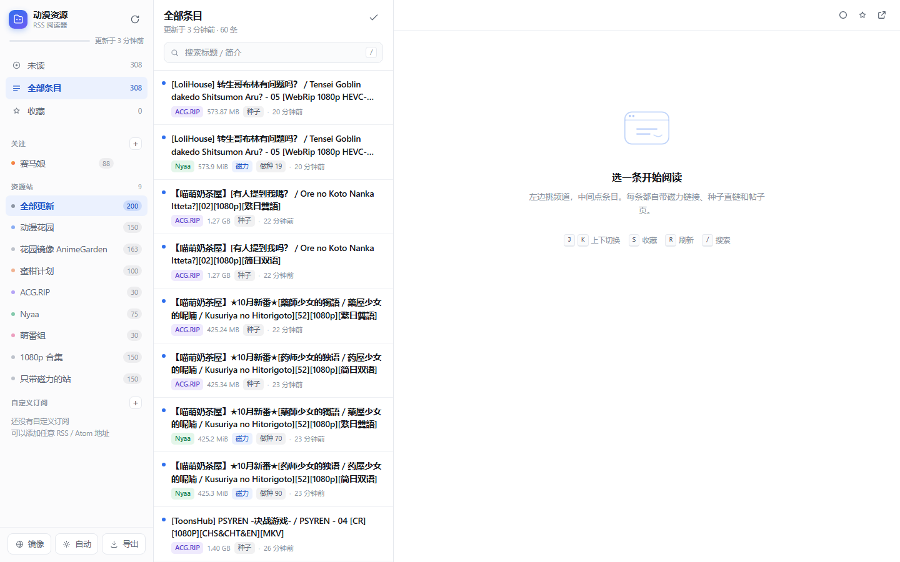
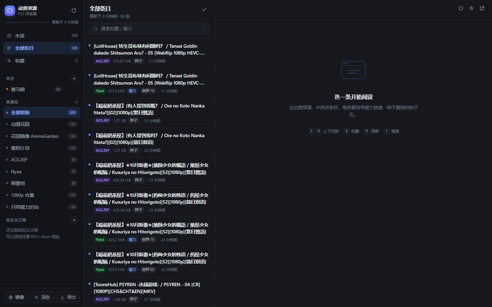
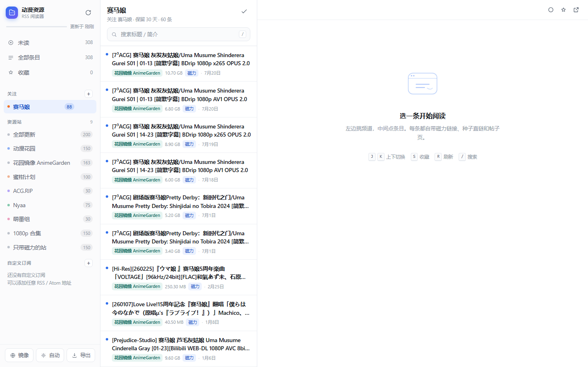
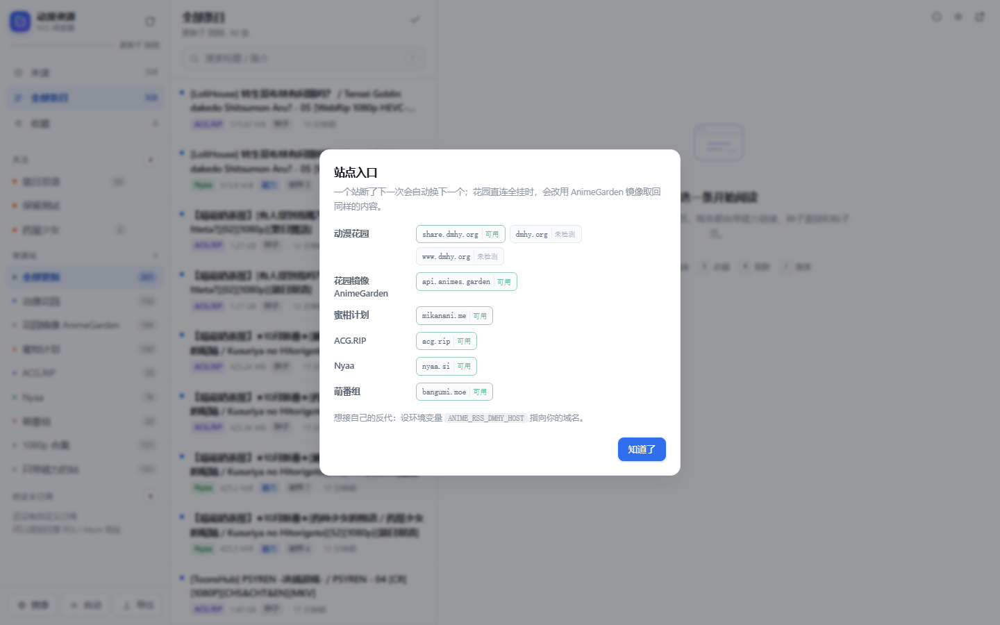
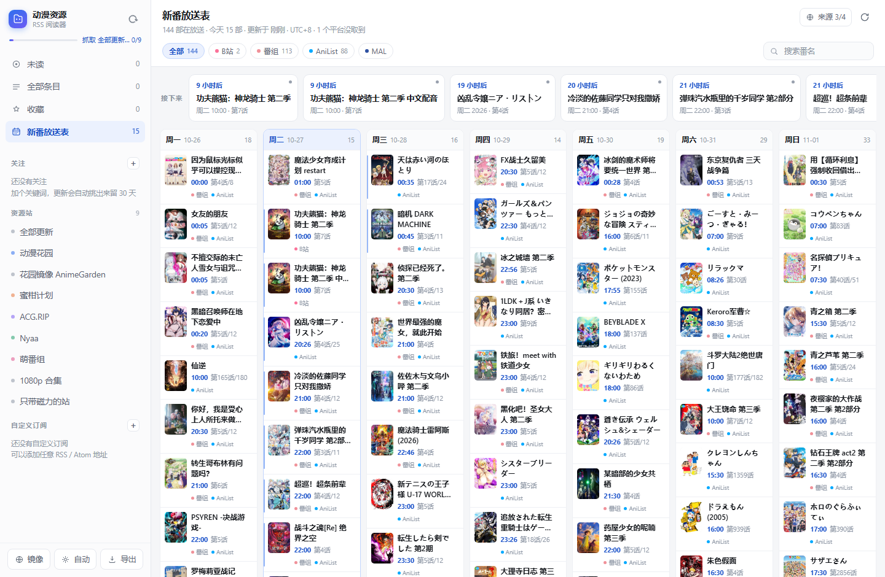
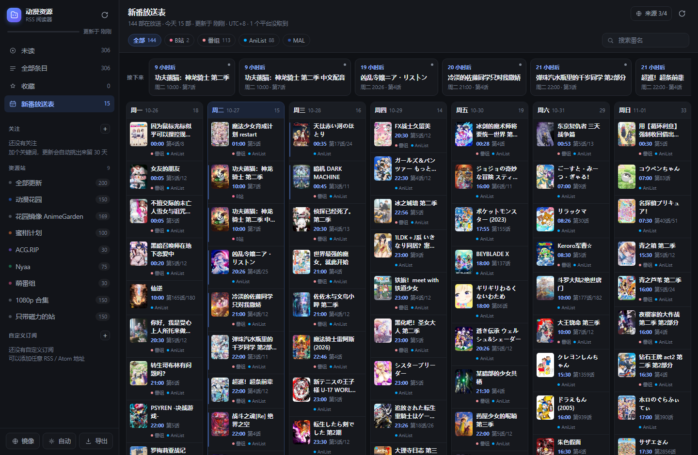
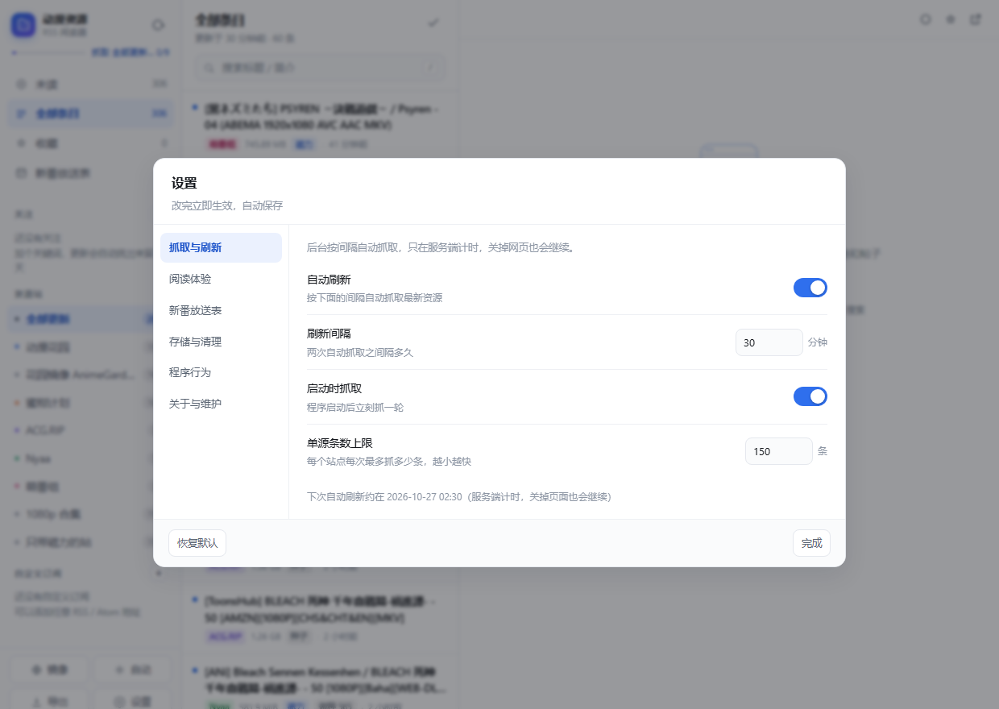
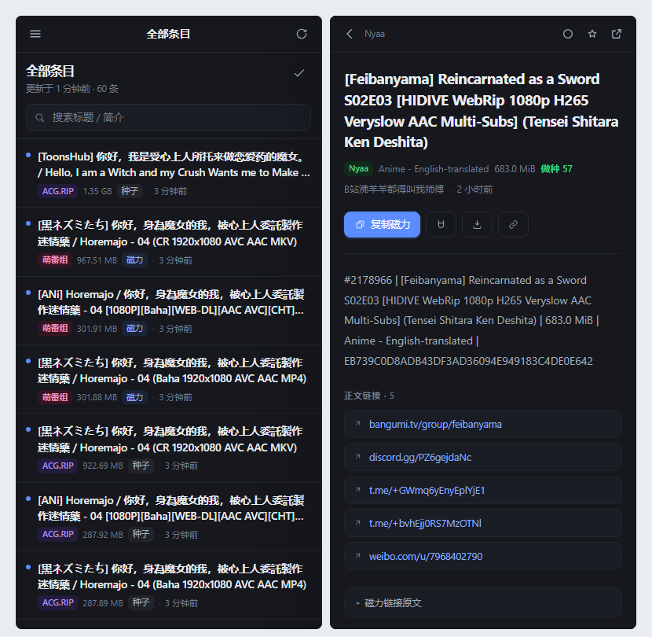

# 动漫资源 · RSS 阅读器

把 [Anesidora-Beta/anime-rss](https://github.com/Anesidora-Beta/anime-rss) 的多站聚合能力，
和一个能直接用的三栏 RSS 阅读器打包成一个**单进程、零依赖**的应用。

打开浏览器就是完整界面：左边选频道，中间翻条目，右边看详情，复制磁力就完事。

```
┌──────────┬───────────────┬──────────────────────────┐
│ 关注     │ 条目列表      │ 详情                     │
│ 频道     │ 标题 · 站点   │ 磁力 / 种子 / 帖子页     │
│ 未读/全部 │ 体积 · 做种数 │ 正文摘要 · 正文外链      │
└──────────┴───────────────┴──────────────────────────┘
```

## 界面预览

| 浅色 · 全部更新 | 深色 · 全部更新 |
|---|---|
|  |  |

| 关注某部番（保留 30 天） | 镜像状态（站挂了自动换入口） |
|---|---|
|  |  |

| 新番放送表 · 浅色 | 新番放送表 · 深色 |
|---|---|
|  |  |

## 它是什么

| | 原仓库 | 本整合包 |
|---|---|---|
| 抓取六个站 | ✅ | ✅ 沿用原解析逻辑，未改动 |
| 磁力规整 / 跨站去重 | ✅ | ✅ |
| 输出 RSS 给别的阅读器 | ✅ | ✅ 仍然保留 |
| 自己就是阅读器 | ❌ | ✅ 三栏界面、已读、收藏、搜索 |
| 数据落地 | ❌ 每次现抓 | ✅ SQLite 本地库，历史可追溯 |
| 关注某部番并保留一个月 | ❌ | ✅ 关键词自动提取，命中留 30 天 |
| 站挂了自动换镜像 | ❌ | ✅ 多入口轮换 + AnimeGarden 兜底 |
| 手机 / 平板访问 | ⚠️ 只看订阅链接 | ✅ 响应式界面，抽屉 + 全屏阅读 |
| 任意 RSS 订阅 | ❌ | ✅ 自定义订阅源自动识别磁力/种子 |
| 新番放送时间表 | ❌ | ✅ 四个平台合并成一张周历，直接关注 |

> 只做聚合与索引，不存储、不缓存、不分发任何资源文件。所有磁力与种子都指向原站。

## 快速开始

### Windows · 免安装（最简单）

双击 `AnimeRSSReader.exe`，会弹出一个**没有地址栏和标签页的独立窗口**（用本机 Chrome/Edge 的 `--app` 模式渲染）。

**关闭窗口时会弹框让你选**（弹框置顶显示，不会被别的程序盖住）：

- 选【是】→ 退出程序，服务停止
- 选【否】→ 留在后台继续运行，手机 / 其它浏览器仍可访问，控制台自动缩到任务栏

弹框弹出时主窗口会先补回在它后面（看起来就是“窗口没关、从里面问你要不要退出”），选完之后窗口才真正消失。

想回来看界面？**再双击一次 exe 就行**，它会认出正在跑的实例并直接把窗口接回去，不会开第二个服务。
后台状态下想彻底退出：在任务栏把控制台窗口还原，按 `Ctrl+C` 或直接关掉它。

- 不需要装 Python，单个文件约 9.4 MB，可放在任意目录（含 U 盘）。
- 第一次启动会在 exe **同级目录**自动建立 `data\reader.db`，把 exe 和 data 目录一起拷走即可带走已读/收藏状态。
- 关闭那个黑色命令行窗口，或按 `Ctrl+C`，即可停止服务。
- 端口被占用会自动顺延到 8900、8901……

### Windows · 源码方式

双击 `start-windows.bat`（需要 Python 3.9+，无需 `pip install` 任何东西）。

### macOS

双击 `start-mac.command`。首次若提示「无法打开」，在终端执行一次：

```bash
cd 解压后的目录
chmod +x start-mac.command start-unix.sh
./start-mac.command
```

### Linux / NAS

```bash
cd anime-rss-reader
./start-unix.sh            # 或 python3 app.py
```

### Docker

```bash
docker compose up -d        # 数据挂到 ./data
# 或者
docker build -t anime-rss . && docker run -d -p 8899:8899 -v "$PWD/data:/data" anime-rss
```

访问 `http://localhost:8899/`。

### 自己打包成单个可执行文件

```bash
pip install pyinstaller
python build_exe.py            # 单文件，产物在 dist/
python build_exe.py --onedir   # 文件夹版，启动更快、便于排查问题
```

PyInstaller 不支持交叉编译，要哪个平台的程序就在哪个平台上跑一次。
图标由 `build_icon.py` 用纯标准库光栅化生成（`icon.ico` / `icon.png`），换配色改文件顶部的常量即可。

## 界面怎么用

**左侧栏** — 四个快捷入口（未读 / 全部条目 / 收藏 / 新番放送表）＋ 关注列表 ＋ 九个内置频道 ＋ 自定义订阅。
数字是未读数，`＋` 新建关注或订阅，鼠标移到关注项上有 `✎` 编辑、`×` 删除。

**中间列表** — 2 行标题、站点徽标、体积、做种数、时间。滚动到底自动加载更多。

**右侧详情** — 一条资源的全部可用信息：

- **复制磁力**（主按钮）— 一键复制，去下载器粘贴即可
- **打开磁力** / **下载种子** / **帖子页** — 三种取资源方式按站点能力出现
- **正文摘要 + 正文外链** — 原站放的各种网盘、字幕、讨论链接都抽出来了
- **磁力原文** — 折叠着，需要时可以手动改 tracker

点开条目即标为已读，`☆` 收藏。

### 快捷键

| 键 | 作用 |
|---|---|
| `J` / `↓` | 下一条 |
| `K` / `↑` | 上一条 |
| `S` | 收藏 / 取消收藏 |
| `M` | 已读 / 未读切换 |
| `T` | 切换新番放送表 |
| `R` | 抓取最新（在放送表里是重新抓放送时间） |
| `/` | 聚焦搜索 |
| `,` | 打开设置 |
| `Esc` | 关闭阅读区 / 弹窗（在放送表里退回条目列表） |

### 主题

左下角按钮循环切换：**自动 → 浅色 → 深色**，也可以到设置里改，选择会记住并同步到服务端。

## 设置

左下角 **设置**（或按 `,`）打开，分五组，改完立即生效、自动保存：



| 分组 | 设置项 |
|---|---|
| 抓取与刷新 | 自动刷新开关、刷新间隔（5–1440 分钟）、启动时抓取、单源条数上限（50–500） |
| 阅读体验 | 主题、正文字号（小 / 标准 / 大 / 特大）、列表密度（宽松 / 紧凑）、点开即已读、键盘快捷键开关 |
| 新番放送表 | 数据来源开关（B站 / Bangumi / AniList / MAL）、缓存有效期（1–48 小时）、开播桌面通知 |
| 存储与清理 | 保留天数、条目上限 |
| 程序行为 | 关闭窗口时的动作（先问我 / 留在后台 / 直接退出） |
| 关于与维护 | 版本、访问地址、数据文件位置、条目数与数据库大小，以及「立即清理旧条目」「压缩数据库」 |

几个说明：

- **自动刷新在服务端计时**，关掉网页、手机断开都照常执行；页面上的「下次自动刷新」时间就是服务端算出来的。
- 关掉某个放送表来源后，它不会再被抓取，已有数据在下一次刷新后消失；至少要留一个来源。
- 「清理」只删超过保留天数的**未收藏**条目，收藏和关注命中的条目不受影响。
- 设置存在数据库里，和已读/收藏一起走，拷走 `data` 目录就带走了整套偏好。

## 内置频道

| 频道 | 说明 |
|---|---|
| 全部更新 | 六个站合并、跨站去重后按时间倒序 |
| 动漫花园 | share.dmhy.org，中文资源最全，默认只留动画 / 季度全集 / RAW |
| 花园镜像 AnimeGarden | 动漫花园的官方镜像 + BT 聚合站，国内可达性更好 |
| 蜜柑计划 | mikanani.me，番剧订阅为主，给种子直链 |
| ACG.RIP | acg.rip，WebRip 画质好，字幕组集中 |
| Nyaa | nyaa.si，国际站 RAW 与英译，带做种数 |
| 萌番组 | bangumi.moe，磁力完整，带做种数 |
| 1080p 合集 | 标题含 `1080p` 的全部条目 |
| 只带磁力的站 | 仅动漫花园 / Nyaa / 萌番组 |

## 关注列表

盯某部番、某个字幕组、某个分辨率，不用每次翻列表。侧栏「关注」旁边 `＋` 新建：

| 字段 | 说明 |
|---|---|
| 名称 | 侧栏显示的名字，留空就用关键词 |
| 必须包含 | 空格分隔，**全部**都要命中标题。如 `芙莉莲 简日` |
| 排除词 | 命中任意一个就跳过。如 `合集` |
| 字幕组 | 逗号或空格分隔，命中任一即可。如 `喵萌奶茶屋,LoliHouse` |

**自动提取**：每次抓取结束都会把近 60 天的条目重新跑一遍关注规则，
所以关注是后加的、或者上个频道刚抓到的内容，也能立刻被挑出来。

**保留一个月**：命中的条目从命中那天起单独保留 30 天 —— 即使源站的 RSS 已经翻页滚掉、
主库按常规策略清掉了，关注里仍然看得到。侧栏副标题会显示「保留 N 天」。
被关注引用的条目不会主库清理，关注记录过期后条目才随之释放。

关注条目同样支持未读计数、全部已读、收藏、搜索。

## 新番放送时间表

侧栏第四项就是它，快捷键 `T`。打开就是一张当季周历，**四个平台的放送安排合并成一条**，
不用在几个网站之间来回对照。

| 平台 | 提供什么 |
|---|---|
| 哔哩哔哩 | 官方追番时间表，精确到分钟，中文标题与封面 |
| Bangumi 番组计划 | 每周放送表，中日文标题、评分、追番人数 |
| AniList | 全球放送时间戳，下一集集数与总集数 |
| MyAnimeList | Jikan 公共接口，英 / 日文标题与放送日（连不上会自动跳过） |

**怎么合并的**：同一部番在不同平台叫法不一样，程序用「中文名 / 日文名 / 罗马字名」三套键
把各平台的记录串起来 —— Bangumi 同时有中日文名，正好当中间人：B 站的中文标题和它的
`name_cn` 对上，AniList 的原名和它的 `name` 对上，于是 B 站 → Bangumi → AniList 串成一条链。
最后再用中文标题相似度兜一遍（季数不同的一律不并）。合并之后一部番只出现一次，
卡片上标出所有来源，详情里还能看到「合并自 A + B」。

**能做什么**

- 周历按周一到周日排，今天那一列高亮；点卡片看详情（封面、别名、各平台入口）
- 顶部「接下来」横向条：按倒计时排最近要更新的几部，30 秒自动走一次
- 卡片上的 `★` 或详情里的「关注这部番」→ 直接建一条关注，抓到资源后自动挑出来
- 「在资源里搜」→ 拿番名跳回条目列表搜索，直接找字幕组发的资源
- 平台筛选条 + 番名搜索；窄屏自动切成「按天切换」，手机上一屏一天

**什么时候更新**：打开时先读本地缓存，超过 6 小时就后台刷一轮（不挡界面）；
右上角刷新按钮强制重抓。抓回来的周历存在 `data/reader.db` 里，断网也能照常翻。
单个平台连续失败 3 次会暂时跳过 20 分钟，手动刷新可立刻重试 —— 比如 MAL 的 Jikan 接口
在部分网络下连不上，其余三个平台照常工作，界面上会标出「1 个平台没取到」。

> 放送时间统一换算成北京时间（UTC+8）。Bangumi 只给「星期几」，所以那一类条目时间显示为「待定」。

## 镜像与国内网络

每个站点可以有多个入口，抓取时按「上次成功的优先、冷却中的靠后」排序逐个尝试：

| 站点 | 入口 |
|---|---|
| 动漫花园 | `share.dmhy.org` → `dmhy.org` → `www.dmhy.org` |
| 花园镜像 AnimeGarden | `api.animes.garden` |
| 其它站 | 各自单一入口 |

失败的入口会冷却 10 分钟，避免每次都卡在超时上。

**国内网络兜底**：如果动漫花园的三个域名全部连不上，会自动改走 AnimeGarden 的
`/resources/dmhy` 接口取回同一批资源（内容本来就是花园的，仍归在「动漫花园」频道下），
刷新状态里会提示「已用镜像 AnimeGarden 取到 N 条」。

左下角「镜像」按钮可以随时查看每个入口当前的状态（可用 / 冷却中 / 未检测）。

想接自己的反代，把环境变量指过去即可，它会排在最前面优先使用：

```bash
ANIME_RSS_DMHY_HOST=https://my-mirror.example.com
```

## 自定义订阅

点侧栏「自定义订阅」旁边的 `＋`，填任意 RSS / Atom 地址即可。抓取时会自动识别：

- `magnet:` 链接 → 显示「复制磁力 / 打开磁力」
- `enclosure` 里的 `.torrent` → 显示「下载种子」
- `nyaa:seeders` / `nyaa:size` 之类的扩展字段 → 显示做种数与体积
- 普通博客 / 资讯源 → 当文章读，正文与链接照常显示

## 手机 / 平板访问

```bash
python3 app.py --lan          # Windows: start-windows.bat --lan
```

启动后终端会打印一个 `http://192.168.x.x:8899/` 的地址，同一 WiFi 下用手机浏览器打开即可。
界面在窄屏下会自动切换成：顶部栏 + 单列列表 + 全屏阅读页。



## 给别的阅读器订阅

本应用同时还是一个标准 RSS 服务，把条目导出给手机上更顺手的阅读器也行：

- 全部条目：`http://<host>:8899/feed.xml`
- 单个频道：`http://<host>:8899/feed/dmhy.xml`（id 见 `api/bootstrap`）
- 全部订阅的 OPML：`http://<host>:8899/opml.xml`（可一次性导入别的阅读器）

点侧栏「导出」按钮可以直接看到并复制这几个地址。

## 命令行参数

```bash
python app.py [选项]

  --port 8899       端口（被占用时自动往后顺延）
  --lan             监听 0.0.0.0，开放给同 WiFi 的设备
  --host 1.2.3.4    手动指定监听地址
  --browser         用系统默认浏览器开普通标签页（默认是独立窗口）
  --window-size     独立窗口尺寸，默认 1240,880
  --on-close ask    关窗后怎么办：ask 弹框询问（默认）/ exit 直接退出 / background 留在后台
                    （不写这个参数时，用「设置 → 程序行为」里选的动作）
  --no-browser      启动后不自动打开任何界面
  --no-fetch        启动后不自动抓取
```

**关于"为什么要打开浏览器"**：后端是本地 HTTP 服务，界面是网页，所以需要一个渲染器。
默认用 Chrome/Edge 的 `--app` 模式开一个无地址栏的独立窗口（独立 `user-data-dir`，
不干扰日常浏览器），观感与普通桌面软件一致；没装这两种浏览器时退回系统默认浏览器。

环境变量：`PORT`、`HOST`、`ANIME_RSS_DATA`（数据目录）、`ANIME_RSS_ON_CLOSE`（同 `--on-close`）、
`ANIME_RSS_KEEP_ALIVE=1`（等价于 `--on-close background`）、`ANIME_RSS_QUIET=1`（不打印访问日志）。

## 数据与备份

```
data/reader.db     SQLite：订阅源配置、条目、已读/收藏状态、关注、新番放送表、用户设置
```

- 抓取到的条目默认保留 **30 天**（收藏的不受限制），总量上限 3 万条，超了自动淘汰最旧的未收藏条目
- 这两个数字都能在「设置 → 存储与清理」里改，改完下次抓取就按新值清理
- 备份 = 复制 `data/` 目录；换机器把整个文件夹带走也行
- 想重来：删掉 `data/reader.db` 重启即可

## 文件结构

```
anime-rss-reader/
├─ app.py              HTTP 服务 + API 路由 + 窗口监督 + 启动逻辑
├─ feeds.py            聚合引擎：多站抓取、镜像轮换、通用 RSS 解析、导出
├─ sources.py          各站适配层（源自原仓库，新增 AnimeGarden）
├─ schedule.py         新番放送表：四个平台的放送时间抓取、跨平台合并、周历缓存
├─ settings.py         用户设置：默认值、校验、持久化、后台定时刷新线程
├─ textutil.py         清洗：纯文本、外链、磁力规整、时间解析
├─ store.py            SQLite 存储：去重写入、查询、已读收藏、关注匹配、放送表
├─ static/
│  ├─ index.html       页面骨架
│  ├─ style.css        全部样式（深浅主题 / 响应式）
│  ├─ app.js           全部前端逻辑（原生 JS，无框架）
│  └─ icon.svg
├─ start-windows.bat   Windows 启动
├─ start-mac.command   macOS 双击启动
├─ start-unix.sh       Linux / NAS 启动
├─ Dockerfile          容器镜像
├─ docker-compose.yml
├─ build_exe.py        单文件可执行打包
├─ build_icon.py       生成 icon.ico（纯标准库）
├─ icon.ico / icon.png 程序图标
├─ preview/            README 用的界面截图
├─ dist/               打包产物（自己跑 build_exe.py 后生成）
└─ data/               运行时生成
```

## API（想自己接脚本的话）

| 方法 | 路径 | 说明 |
|---|---|---|
| GET | `/api/bootstrap` | 频道、计数、站点、局域网地址 |
| GET | `/api/items?feed=&filter=&q=&limit=&offset=` | 条目列表（`filter` = `all`/`unread`/`starred`/`magnet`） |
| GET | `/api/item/<id>` | 单条详情 |
| POST | `/api/read` | `{ids:[...], read:true}` |
| POST | `/api/star` | `{id, starred:true}` |
| POST | `/api/read-all` | `{feed}` 整个频道标为已读 |
| POST | `/api/refresh` | 触发抓取（后台跑） |
| GET | `/api/refresh` | 抓取进度 |
| POST | `/api/feeds` | `{title, url}` 添加自定义订阅 |
| PATCH | `/api/feeds/<id>` | 改名 / 启停 / 改筛选参数 |
| DELETE | `/api/feeds/<id>` | 删除自定义订阅 |
| GET | `/api/watches` | 关注列表（含命中数、未读数、剩余保留天数） |
| POST | `/api/watches` | `{name, include, exclude, fansub}` 新建并立即匹配 |
| PATCH | `/api/watches/<id>` | 改名 / 改关键词 / 启停（会重新匹配） |
| DELETE | `/api/watches/<id>` | 删除关注 |
| POST | `/api/watches/<id>/scan` | 手动重跑一次匹配 |
| GET | `/api/schedule` | 新番放送表（`?refresh=1` 顺带触发重抓） |
| GET | `/api/schedule/status` | 放送表抓取进度 |
| POST | `/api/schedule/refresh` | 强制重新抓取各平台放送时间 |
| GET | `/api/mirrors` | 各站点入口状态（可用 / 冷却中 / 未检测） |
| GET | `/api/settings` | 当前设置值 + 各设置项的类型定义 + 运行信息 |
| POST | `/api/settings` | `{values:{...}}` 只改传进来的那几项 |
| POST | `/api/settings/reset` | 恢复全部默认值 |
| POST | `/api/maintenance` | `{action:"clean"}` 清理旧条目 / `{action:"vacuum"}` 压缩数据库 |
| POST | `/api/open-window` | 让已有实例把界面窗口重新打开 |
| GET | `/feed.xml`、`/feed/<id>.xml`、`/opml.xml` | RSS / OPML 导出 |

条目列表的 `feed` 参数也接受 `watch:<关注id>`，取该关注命中的条目。

## 常见问题

**抓不到内容？**
先看左下角「镜像」里各入口的状态。动漫花园在国内常被阻断，程序会自动切到镜像域名，
再不行会走 AnimeGarden 兜底，一般不需要代理。其它站点如果连不上，再考虑设置代理：

```bash
# Windows
set HTTPS_PROXY=http://127.0.0.1:7890 && start-windows.bat
# macOS / Linux
HTTPS_PROXY=http://127.0.0.1:7890 ./start-unix.sh
```

**端口被占用？**
会自动往后找，终端里显示的地址以实际打印为准；也可以 `--port 9000` 手动指定。

**首次打开列表是空的？**
首次运行会自动在后台抓一轮（约 5–15 秒），列表会自动刷新出内容。也可以点右上角刷新按钮或按 `R`。

**新番放送表是空的？**
点放送表右上角的刷新按钮重抓一次。抓取时四个平台是并发请求的，通常 2–5 秒出结果；
点「来源」能看到每个平台取到多少部、耗时多少、失败原因。MAL 走的是 Jikan 公共接口，
个别网络环境连不上属正常，其余三个平台照常出表。

**Windows 提示 Python 未安装？**
装 [Python 3.9+](https://www.python.org/downloads/)，安装时勾选 *Add Python to PATH*。

**杀毒软件报毒？**
用 PyInstaller 打包的单文件 exe 偶发误报，源码运行不会有这个问题。

## 致谢

- 站点适配、磁力规整、跨站去重的原始实现来自 [Anesidora-Beta/anime-rss](https://github.com/Anesidora-Beta/anime-rss)，本包保留其逻辑未作改动。
- 前端、存储、阅读器与打包部分为本整合包新增。

仅用于个人订阅与索引，请遵守各资源站的使用条款与当地法律法规。

## 许可

[MIT](LICENSE)
