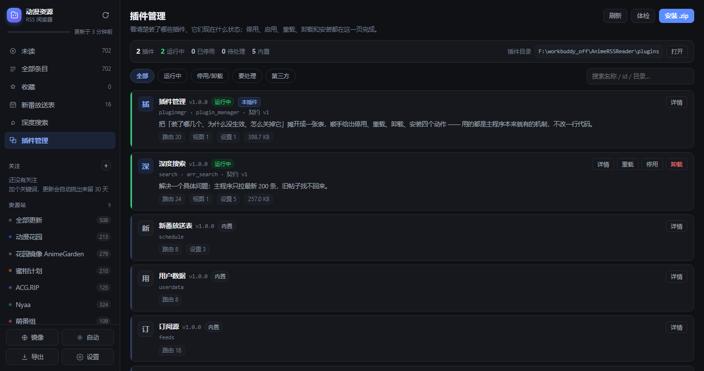

# plugin_manager —— 插件管理器

> 把「装了哪几个、为什么没生效、怎么关掉它」摊开成一张表，顺手给出停用、
> 重载、卸载、安装四个动作 —— 用的都是主程序本来就有的机制，不改一行代码。

主程序「装了就跑、出错就跳过」对启动稳定性很好，但把两件事留给了用户：
**看不见**（装了哪几个、为什么没生效）和**关不掉**（一个插件抢路由、天天报错，
除了手动删目录没别的办法，而 `plugins/` 在哪第一次用的人根本找不到）。



```
                     ┌──────────────────────────────────────────┐
                     │  侧栏「插件管理」                         │
                     │  /plug/pluginmgr/view.js                 │
                     └───────────────┬──────────────────────────┘
                                     │ /api/pluginmgr/*
        ┌────────────────────────────┴───────────────────────────┐
        │  module.py      路由、视图声明、设置分组                │
        ├────────────────────────────────────────────────────────┤
        │  registry.py    磁盘探测 × 内存实况 → 插件档案（状态机） │
        ├────────────────────────┬───────────────────────────────┤
        │  probe.py（只读）       │  control.py（会动手）          │
        │  ast 解析，不 import    │  摘路由/视图/任务、移目录、装包  │
        └────────────────────────┴───────────────────────────────┘
                                     │
                     真实落点：ctx.router / ctx.views / ctx.jobs /
                     ctx.modules + 磁盘上的 plugins/.disabled/ .removed/
```

## 一、两个关键判断

**1. 停用必须真的停。** 只写一个 `enabled=false` 是骗人的：插件照样 import、照样挂路由。
所以停用同时做两件事，缺一不可：

| 层面 | 做法 | 少了它会怎样 |
|---|---|---|
| 磁盘 | 目录移进 `plugins/.disabled/` | 重启后又被加载（`discovery` 跳过 `.` 开头的条目） |
| 运行时 | 摘掉路由、视图、静态挂载、定时任务、模块注册表 | 界面说停了，接口还能打 |

**2. 清单不能靠 import。** 插件加载失败时恰恰不能再去 import 它 —— 而这正是最需要
展示信息的时刻。所以清单由 `probe.py` 用 `ast` 读出来：`id / name / version /
api_version / depends / views / assets`，连 `__init__.py` 里只做转发的写法
（`from .module import Xxx`，以及 `arr_search` 用的 PEP 562 `__getattr__` 延迟导入）都能跟上。

## 二、状态机

状态不是「我们记了什么」，而是**磁盘与内存对完之后的事实**。难点全在不一致上：

| 磁盘 | 进程 | 状态 | 界面提示 |
|---|---|---|---|
| `plugins/foo` | 已加载 | `normal` 运行中 | — |
| `plugins/foo` | 没加载 | `stale` 待加载 | 刚放进去没重启 |
| `plugins/foo`（探测报错） | 没加载 | `broken` 加载失败 | 第几行语法错、或 id 与内置重名 |
| `.disabled/foo` | 没加载 | `disabled` 已停用 | 可以启用 |
| `.disabled/foo` | **仍在跑** | `partial` 停用未完成 | 重启后彻底消失 |
| `plugins/foo`（移不动） | 已摘除 | `soft` 本次停用 | 目录只读，启动时自动再摘一次 |
| `.removed/foo@时间` | 没加载 | `removed` 已卸载 | 可以恢复 / 彻底删除 |
| 没有 | 已加载 | `external` 外部安装 | pip 入口点装的，只能重启生效 |
| 内置模块 | 已加载 | `core` 内置 | 只读，不允许停用 |

`partial` 和 `soft` 是刻意分开的：前者是「目录走了人还在」，后者是「人走了目录还在」。
混成一个状态，用户重启一次就会发现管理器在骗他。

## 三、动作语义

| 动作 | 目录 | 运行态 | 可逆性 |
|---|---|---|---|
| 停用 | → `plugins/.disabled/<名>` | 摘掉四件套 | 点「启用」回来 |
| 启用 | ← 移回 `plugins/` | 立刻加载（含 `/api/v1/` 别名） | — |
| 重载 | 不动 | 摘掉旧实例再加载新代码 | — |
| 卸载 | → `plugins/.removed/<名>@<时间>` | 摘掉四件套 | 页面底部「恢复」 |
| 彻底删除 | 删掉 `.removed/...` | — | 不可逆，二次确认 |

顺序永远是**先摘运行态、再动目录**。反过来一旦摘运行态失败，用户会以为卸载了其实还在跑，
那种状态最难查。

## 四、接口

| 路径 | 方法 | 说明 |
|---|---|---|
| `/api/pluginmgr` | GET | 全量快照：档案 + 统计 + 体检 + 环境 |
| `/api/pluginmgr/detail?id=` | GET | 单个插件：路由、视图、文件列表、源码 |
| `/api/pluginmgr/action` | POST | `{action, id}`，action ∈ disable/enable/reload/remove/restore/purge |
| `/api/pluginmgr/install?name=&overwrite=` | POST | body 就是 zip 字节，落盘后立刻加载 |
| `/api/pluginmgr/export?id=` | GET | 把一个插件打回 zip（备份/迁移） |
| `/api/pluginmgr/file?id=&path=` | GET | 读插件里的一个源码文件 |
| `/api/pluginmgr/note` | POST | 给插件写一句备注（存 `data/plugin_manager.json`） |
| `/api/pluginmgr/open` | POST | 在系统文件管理器里打开插件目录 |
| `/api/pluginmgr/journal` | GET | 最近操作记录 |

Python 侧也能直接用：

```python
mgr = ctx.modules.get("pluginmgr")
mgr.control.disable("search")        # 停用
mgr.control.snapshot().counts()      # {'total': 2, 'on': 1, ...}
```

## 五、契约映射（没改主程序）

| 契约 | 用在哪 |
|---|---|
| `Module` 子类 + `setup(ctx)` | 本模块自己就是一个插件，`id="pluginmgr"` |
| `views` / `assets` | 声明侧栏入口，静态目录挂到 `/plug/pluginmgr/` |
| `ctx.router` | 全部路由在 `/api/pluginmgr/*` 下 |
| `ctx.views.all()` / `read()` | 列出与摘除别的插件的视图 |
| `ctx.jobs` | 摘除插件注册的定时任务（`cancel`） |
| `ctx.settings.define` | 设置页多一组，只有一个开关：自动摘除软停用插件 |
| `ModuleRegistry`（公开类） | 摘除模块后重建注册表，`ctx.module(id)` 立刻查不到 |
| `data_dir` | 状态与备注存 `plugin_manager.json`，不进数据库 |

唯一碰私有字段的是 `ViewRegistry` 没有 `unregister()`（只有 `clear()`），
所以对 `_views` 做了一次删除，并整段包在 `try` 里 —— 万一以后改名，最坏结果是
「视图没摘干净、重启后消失」，不会让管理器崩掉。

## 六、安全边界

- **内置模块只读**：`feeds` / `reader` / `schedule` / `settings` / `userdata` 不允许停用，
  拒绝了才不会有「主程序少一块功能」的求助；
- **不能操作自己**：停用自己会让整个页面消失，按钮直接拒绝；
- **zip 安装**：拒绝 `..`、绝对路径、盘符、符号链接、`__pycache__`/`.git`；
  单包 ≤ 24 MB、≤ 3000 个文件；先解到 `.staging-*`，校验有入口文件再原子落位；
  失败自动清理，落位后立刻加载；
- **覆盖安装**：旧版本自动备份进 `.removed/`，不是直接覆盖；
- **不能覆盖安装自己**：包目录名正好是 `plugin_manager`，或包里的模块 `id` 也是
  `pluginmgr`，都在**落盘前**拒绝 —— 否则旧目录会被挪进回收站、新代码又因 id 冲突
  加载不了，等于把自己弄没。要升级管理器请手动替换目录后重启；
- **彻底删除**：只能删 `.removed/` 下的条目，路径必须正好是它，二次确认；
- **读文件**：只能读该插件目录内的文件，`realpath` 前缀校验，文本 ≤ 120 KB。

## 七、已知限制

1. **Windows 文件占用**：插件若在 `teardown` 之后仍留着手柄，移目录会失败并退化成
   `soft`（本次运行停用），此时界面如实标注；
2. **entry_points 装的插件**：没有目录可移，只能禁用运行时，重启后仍会加载；
3. **定时任务重名**：两个插件用同一个 `name=` 注册任务时，后加载的那个 `setup` 会失败 ——
   这是主程序的规则（`jobs` 按名字去重），管理器只能如实报错，不会替它改名；
4. **重载不是热更新前端**：`view.js` 改完要刷新页面（主程序本来就不打包、不哈希）；
5. **`/api/v1/` 别名**：热加载时会照着宿主已有的别名规则补一份，但如果宿主用
   `api_v1=False` 起了服务，就都不会补 —— 与启动时加载的行为一致；
6. **exe 版只能用「主程序带上了」的标准库**：发布版是 PyInstaller 单文件包，
   只打进了 `anime_rss` 真正 `import` 过的模块。插件是运行时从磁盘加载的，
   不在打包分析范围里，所以顶层 `import` 一个主程序没用过的库（例如 `uuid`）
   会 `ModuleNotFoundError`。**而插件发现是整趟 `try` 的 —— 一个插件抛错，
   所有插件都会消失，界面上只看到侧栏空了一格**，日志里只有一行
   「插件发现失败」。`tests/test_frozen_compat.py` 就是守这条的：
   它算出发布环境缺哪些模块，再检查本插件的顶层 import。<br>
   真要在 exe 里用缺的库，就重打包加 `--hidden-import <库>`，别在插件里硬来。

## 八、安装、自检、测试

```bash
# 装：把整个 plugin_manager 目录放进程序的 plugins/
<程序目录>/plugins/plugin_manager/

# 自检（不联网、不动你的数据）
python plugins/plugin_manager/selfcheck.py
python plugins/plugin_manager/selfcheck.py --base D:\AnimeRSSReader

# 单测 + 集成测试（需要主程序在场）
python -m unittest discover -s plugins/plugin_manager/tests -v

# 前端：离线预览 + jsdom 断言
start plugins/plugin_manager/preview/preview.html
node plugins/plugin_manager/tests/check_view.js plugins/plugin_manager/preview/preview.html
```

装好后：侧栏多一个「插件管理」，`/api/pluginmgr` 可用，设置页多一个分组。

## 九、加一个新能力（三步）

1. **只读信息** → 往 `registry.runtime()` 里加采集，或往 `probe` 里加 AST 字段；
   两者都不改状态机，加完自动出现在详情里；
2. **新动作** → 在 `control.Controller` 加方法，在 `module._ACTIONS` 与 `api_action`
   里挂上，前端按钮用 `data-act="..."`；
3. **新状态** → `registry.STATE_TEXT` + `_ORDER` + 前端 `.pm-st-<state>` 的色条与胶囊
   —— 三者都要加，否则卡片会落到默认灰色。

## 十、文件

```
plugin_manager/
├── __init__.py       入口：PEP 562 延迟导入，并给实例绑定自己的插件目录
├── module.py         Module 子类：路由 / 视图声明 / 设置分组
├── registry.py       磁盘 × 内存 → 状态机（含体检建议）
├── control.py        停用 / 启用 / 重载 / 卸载 / 安装 / 导出
├── probe.py          纯 AST 探测，零副作用
├── static/           view.js / view.css
├── preview/          preview.html（假数据，双击就能看界面）
├── tests/            test_probe / test_registry / test_control / check_view.js
└── selfcheck.py      装完自检
```
